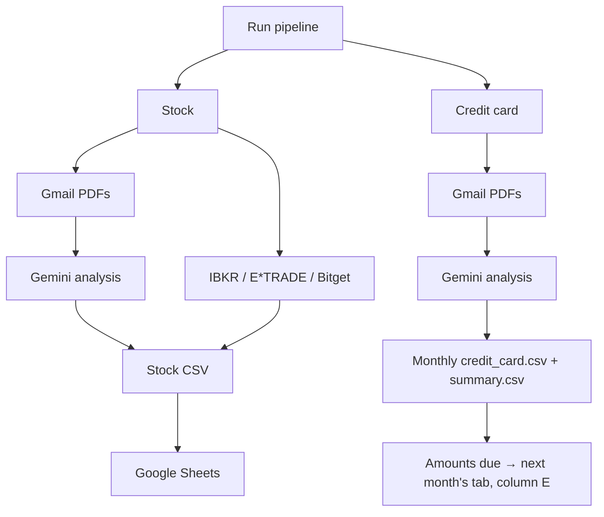

# Integrated Asset Management

Automated pipelines for managing stock/ETF transactions, credit-card statements, and crypto exchange trades — with Google Sheets sync.

## Features

| Pipeline | Description |
|----------|-------------|
| **Stock** | Fetch broker PDF statements from Gmail → decrypt → analyze with Gemini → sync to Google Sheets |
| **Credit Card** | Fetch credit-card PDF statements from Gmail → decrypt → analyze with Gemini → CSV output → amounts due to Google Sheets |
| **Crypto** | Fetch filled Bitget spot orders → merge into `transactions.csv` (a stage of the stock pipeline) |

---

## Working Flow



---

## Pre-work

### 1. Exchange API Keys (for crypto pipeline)

Log in to your exchange account and create an API key:

* **OKX:** [Create API Key](https://www.okx.com/account/my-api) | [API Docs](https://www.okx.com/docs-v5/en/)
* **Bitget:** [Create API Key](https://www.bitget.com/account/newapi) | [API Docs](https://bitgetlimited.github.io/apidoc/en/spot/)
* **Binance:** [Create API Key](https://www.binance.com/en/my/settings/api-management) | [API Docs](https://developers.binance.com/docs/)

### 2. Broker API Access (for stock pipeline)

* **IBKR:** [Flex Web Service](https://www.interactivebrokers.com/campus/ibkr-api-page/flex-web-service). No gateway or login is needed.
  1. In Client Portal, create an Activity Flex Query. Use CSV format with section codes. Include **Trades** at Execution level and **Cash Transactions** with Dividends, Payment in Lieu of Dividends, and Withholding Tax at Detail level. Set the period to the last 30 calendar days.
  2. Under Settings > Flex Web Service, create a token. Set its expiry to 1 year and renew it before it lapses.
  3. Put the token and the query ID in `.env` as `IBKR_FLEX_TOKEN` and `IBKR_FLEX_QUERY_ID`.

  Activity data updates once a day after the close, so a run sees trades up to the previous business day. Dividends are stored net of withholding tax.
* **E*TRADE:** [Developer Portal](https://developer.etrade.com/home) | [API Docs](https://apisb.etrade.com/docs/api/account/api-transaction-v1.html)
  1. Put the consumer key, the consumer secret, and the account ID key in `.env` as `ETRADE_PROD_API_KEY`, `ETRADE_PROD_SECRET_KEY`, and `ETRADE_ACCOUNT_ID`.
  2. Run `python main.py --etrade` in a terminal once. Open the URL it prints, and enter the verifier code. The token is saved to `etrade_token.json`. A scheduled run skips E*TRADE when the token has expired.

  Only Bought, Sold, Dividend, and Qualified Dividend transactions become rows. Dividends are stored net of the Tax Withholding booked on the same day for the same symbol. Transfers, deposits, and interest are skipped. History goes back two years and is fetched in pages of 50.

### 3. Google Cloud Console

1. Create a project in [Google Cloud Console](https://console.cloud.google.com/).
2. Enable the **Gmail API** and **Google Sheets API**.
3. Create OAuth 2.0 credentials and download `credentials.json` to the project root.

### 4. Gemini API Key

1. Get your API key from [Google AI Studio](https://aistudio.google.com/apikey).
2. Follow the [Gemini API Quickstart](https://ai.google.dev/gemini-api/docs/quickstart) to verify your key.

#### Optional: analyze with Claude instead of Gemini

Set `LLM_PROVIDER=claude` to run Stage 3 through Claude. This path works **only if [Claude Code](https://code.claude.com/docs) is installed and logged in** on the same machine. The pipeline runs the local `claude` command, so it uses your Claude Code login (for example a Pro subscription) and needs no Anthropic API key. Each PDF counts against that subscription's usage limits.

1. Install Claude Code and run `claude` once to log in.
2. Confirm `claude --version` works in the terminal that runs the pipeline.
3. Set `LLM_PROVIDER=claude` in `.env`.

If `claude` is not on `PATH`, the pipeline stops at the start of Stage 3 with `claude CLI not found on PATH`. Without `LLM_PROVIDER=claude`, Gemini is used and Claude Code is not needed.

### 5. Environment Variables

Create a `.env` file in the project root:

> **Important:** Keep all keys, secrets, and passwords private.

```env
# --- Exchange API Keys ---
OKX_API_KEY=your_okx_api_key
OKX_SECRET_KEY=your_okx_secret_key
OKX_PASSPHRASE=your_okx_passphrase

BITGET_API_KEY=your_bitget_api_key
BITGET_SECRET_KEY=your_bitget_secret_key
BITGET_PASSPHRASE=your_bitget_passphrase

BINANCE_API_KEY=your_binance_api_key
BINANCE_SECRET_KEY=your_binance_secret_key

# --- IBKR Flex Web Service ---
IBKR_FLEX_TOKEN=your_flex_token
IBKR_FLEX_QUERY_ID=your_flex_query_id

# --- Gemini ---
GOOGLE_API_KEY=your_gemini_api_key

# --- Optional: analyze with Claude instead of Gemini ---
# Requires Claude Code installed and logged in; uses its login, no API key needed.
# LLM_PROVIDER=claude            # default: gemini
# CLAUDE_MODEL=claude-sonnet-5-5 # default; e.g. claude-opus-5-5 for higher accuracy

# --- Google Sheets sync ---
GOOGLE_SHEET_ID=your_spreadsheet_id_or_url
GOOGLE_CARD_SHEET_ID=your_card_spreadsheet_id_or_url

# --- PDF passwords (stock brokers) ---
PDF_PASSWORD=your_cathay_pdf_password
FUBON_PDF_PASSWORD=your_fubon_pdf_password

# --- PDF filename patterns (stock brokers) ---
CATHAY_US=regex_for_cathay_us_statements
CATHAY_TW=regex_for_cathay_tw_statements
FUBON_US=regex_for_fubon_us_statements
TW_DIVIDEND=regex_for_tw_dividend_statements

# --- Credit card filename patterns & passwords ---
CATHAY_CARD=regex_for_cathay_card
CATHAY_CARD_PASSWORD=your_password
# ... repeat for FUBON_CARD, TAISHIN_CARD, MEGA_CARD, SINOPAC_CARD,
#     RAKUTEN_CARD, DBS_CARD, LINEBANK_CARD, SCSB_CARD, UBOT_CARD
```

---

## Usage

### Stock Pipeline

```bash
# Run all stages except sync (fetch → decrypt → analyze → broker API fetch), default last 7 days
python main.py

# Fetch the last 90 days
python main.py --since 90

# Run individual stages
python main.py --fetch
python main.py --decrypt
python main.py --analyze
python main.py --sync

# Fetch broker API transactions and merge into CSV
python main.py --ibkr
python main.py --etrade
python main.py --ibkr --etrade

# Sync CSV to Google Sheets explicitly
python main.py --sync
```

### Credit Card Pipeline

```bash
# Run all card stages
python main.py --card

# Run individual card stages
python main.py --card --fetch
python main.py --card --decrypt
python main.py --card --analyze

# Write amounts due to the card Sheet
python main.py --card --sync
```

`--card` with no stage flag ends with the sync stage. The sync reads the latest `monthly/YYYY-MM/summary.csv`. It writes each bank's amount due into column E of the tab for the next month, so statements that arrive in `2000-01` go to tab `2000/02`. The row for each bank is found by its name in column A. No other column is written.

* The month is written only when it has every bank that the previous month's `summary.csv` has. Until then, each run prints the missing banks and writes nothing.
* The sync writes nothing if the tab does not exist or has no row for a bank. It never creates a tab or a row.
* Each run writes the latest month again, so a value typed by hand into column E of that tab is replaced on the next run.

### Crypto Pipeline

```bash
# Fetch filled Bitget spot orders (BTCUSDT, ETHUSDT) and merge into transactions.csv
python main.py --bitget

# Check that every signed OKX / Bitget / Binance endpoint answers.
# Prints status, record counts, and field names only, never balances.
python -m clients.exchanges
```

### Scheduled Execution

```bash
# Windows Task Scheduler (logs to logs/YYYY-MM-DD.log)
run_pipeline.bat
```

The batch file runs the stock pipeline and then `python main.py --card`. The card run includes the Sheet sync, so a month reaches the Sheet on the first daily run after its last expected statement is analyzed.

---

## Project Structure

```
├── main.py                         # CLI entry point
├── config.py                       # Centralized constants & configs
├── run_pipeline.bat                # Task Scheduler entry with logging
│
├── clients/
│   ├── gmail.py                    # Gmail API client with OAuth2
│   ├── gemini.py                   # Gemini AI client with retry
│   ├── claude.py                   # Claude Code CLI client (same analyze_pdf interface)
│   ├── llm.py                      # LLM_PROVIDER switch: gemini (default) or claude
│   ├── sheets.py                   # Google Sheets sync writer
│   └── exchanges.py                # Signed GETs to OKX / Bitget / Binance + endpoint probe
│
├── models/
│   └── transaction.py              # Transaction & CardTransaction dataclasses
│
├── pipelines/
│   ├── base.py                     # BasePipeline ABC (fetch → decrypt template)
│   ├── stock.py                    # Stock / ETF / dividend pipeline
│   └── card.py                     # Credit-card pipeline
│
├── brokers/
│   ├── base.py                     # BaseBroker ABC
│   ├── ibkr.py                     # IBKR Flex Web Service adapter
│   └── bitget.py                   # Bitget spot order history adapter
│
├── tests/                          # Offline tests: python -m unittest discover -s tests -t .
│
├── utils/
│   ├── csv_helpers.py              # CSV parse, read, write, dedup, normalize
│   ├── pdf_helpers.py              # PDF decrypt & save attachments
│   └── patterns.py                 # Filename pattern matching & tracking
│
├── prompt/                         # Gemini prompt templates
│
└── attachments/
    ├── stock/
    │   ├── raw/                    # Downloaded broker PDFs
    │   ├── decrypted/              # Decrypted broker PDFs
    │   └── transactions.csv        # Merged stock + crypto transactions
    └── card/
        ├── raw/                    # Downloaded card PDFs
        ├── decrypted/              # Decrypted card PDFs
        └── monthly/                # Source of truth by statement month
            └── YYYY-MM/
                ├── credit_card.csv # Monthly transaction rows
                └── summary.csv     # Monthly amount due by bank
    ```
